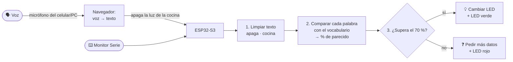
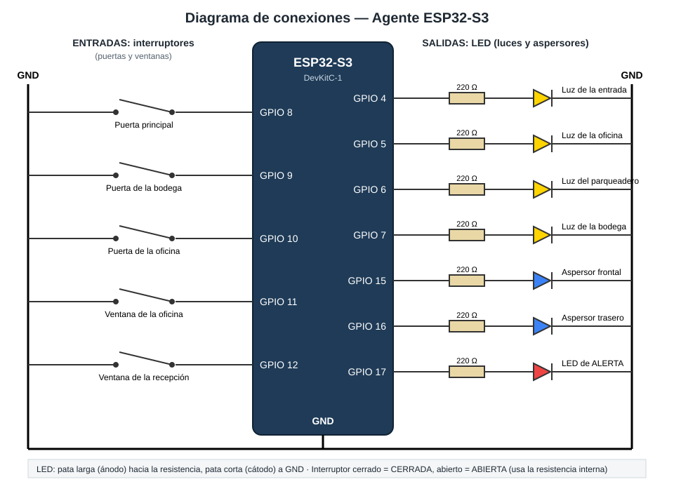

# 🎙️ Asistente de voz con ESP32-S3 — Luces de una empresa

Proyecto final de **Inteligencia Artificial y Sistemas Embebidos** · **Parte 1**

Un asistente de voz que controla las luces de una empresa de **un solo piso**. Cada
habitación tiene su luz, representada por un **LED**. Le dices:

> 🗣️ «Apaga la luz de la cocina»

…y la ESP32 **interpreta la frase ella misma** (sin internet ni inteligencia artificial
externa). Calcula **qué porcentaje se parece** cada palabra que escuchó a las palabras que
conoce, decide qué quisiste decir y **apaga el LED de la cocina**. Un LED verde confirma que
entendió.

```
 "apaga la luz de la cosina"   (el reconocimiento de voz se equivocó en una letra)

  ENCENDER       ####......  43%
  APAGAR         ##########  100%  apaga ~ apaga        ← acción elegida
  Recepción      ##........  29%
  Oficina        ####......  43%
  Cocina         ########..  83%  cosina ~ cocina      ← lugar elegido (supera el 70 %)
  ...
  OK  Listo: apagué la luz de: Cocina   (confianza 91 %)
```

---

## 📋 Contenido

1. [¿Qué hace?](#-qué-hace)
2. [¿Cómo funciona?](#-cómo-funciona)
3. [Conexiones](#-conexiones)
4. [Puesta en marcha rápida](#-puesta-en-marcha-rápida)
5. [Cómo usarlo](#️-cómo-usarlo)
6. [Organización del código](#-organización-del-código)
7. [Documentación](#-documentación)

---

## ✨ ¿Qué hace?

| Lo que dices | Lo que hace |
|--------------|-------------|
| «Apaga la luz de la cocina» | Apaga **un** LED |
| «Enciende la oficina y la recepción» | Enciende **varios** LED |
| «Prende todas las luces» / «Apaga las luces» | Enciende o apaga **todos** |
| «Apaga la **cosina**» / «**Ensiende** el despacho» | Entiende aunque haya errores de reconocimiento |
| «Desactiva el almacén» | Entiende **sinónimos** (almacén = bodega) |
| «Enciende la luz» | Pregunta **dónde** (LED rojo) |
| «Hola, ¿cómo estás?» | Dice que **no entendió** (LED rojo) |

Además muestra, para cada orden, la **tabla de porcentajes** de parecido entre las palabras
dichas y las conocidas, tanto en la página web como en el Monitor Serie.

## 🧠 ¿Cómo funciona?



1. **Voz a texto:** lo hace el navegador (Google Chrome) con su micrófono. La ESP32 recibe el texto.
2. **Limpieza:** minúsculas, sin tildes ni signos; se quitan palabras sin significado ("la", "de", "luz"...).
3. **Porcentaje de parecido:** cada palabra se compara con el **vocabulario** del asistente
   usando la **distancia de Levenshtein** (cuántas letras hay que cambiar). Por ejemplo,
   «cosina» → «cocina» es 1 cambio de 6 letras = **83 %** de parecido.
4. **Decisión:**
   - **Qué hacer:** la acción (encender/apagar) con mayor porcentaje.
   - **Dónde:** las habitaciones que superen el **70 %**, o todas.
5. **Acción:** cambia los LED y parpadea el verde (entendió) o el rojo (no entendió).

➡️ Explicación completa, con ejemplos y cómo "entrenarlo" con palabras nuevas: **[docs/COMO_FUNCIONA.md](docs/COMO_FUNCIONA.md)**

## 🔌 Conexiones



| GPIO | LED | Representa |
|:--:|-----|------------|
| 4 | 🟡 amarillo | Recepción |
| 5 | 🟡 amarillo | Oficina |
| 6 | 🟡 amarillo | Sala de juntas |
| 7 | 🟡 amarillo | Cocina |
| 15 | 🟡 amarillo | Baño |
| 16 | 🟡 amarillo | Bodega |
| 17 | 🟢 verde | Orden entendida |
| 18 | 🔴 rojo | No entendí |

Cada LED: `GPIO → resistencia de 220 Ω → pata larga del LED · pata corta → GND`

**Materiales:** 1 ESP32-S3 · 6 LED amarillos · 1 verde · 1 rojo · 8 resistencias de 220 Ω ·
protoboard · cables · cable USB de datos.

➡️ Detalles: **[docs/CONEXIONES.md](docs/CONEXIONES.md)**

## 🚀 Puesta en marcha rápida

> 📘 ¿Primera vez? Sigue el **[tutorial paso a paso](docs/TUTORIAL.md)**.

1. **Arduino IDE 2** → instala la placa **esp32** (Espressif, versión 2.0.17) y la librería **ArduinoJson** (v7).
2. Abre `AgenteESP32/AgenteESP32.ino`.
3. Crea en esa carpeta un archivo **`credenciales.h`** con tu Wi-Fi (no se sube a GitHub):
   ```cpp
   #define WIFI_NOMBRE  "MiRed"
   #define WIFI_CLAVE   "MiClave"
   ```
4. Placa **ESP32S3 Dev Module**, tu puerto COM → **Subir**.
5. Abre el **Monitor Serie (115200)** y copia la dirección que aparece, por ejemplo `http://192.168.1.60`.
6. Ábrela en **Google Chrome** (en la misma red Wi-Fi), pulsa 🎤 y habla.

**No necesitas ninguna clave de API ni pagar nada:** toda la interpretación ocurre dentro de la ESP32.

## 🖥️ Cómo usarlo

Tienes tres formas de darle órdenes. Las tres pasan por el **mismo intérprete**:

| Forma | Cómo |
|-------|------|
| 🎤 **Voz** | En la página, pulsa el micrófono y habla (Google Chrome) |
| ⌨️ **Texto en la página** | Escribe la orden y pulsa *Enviar*, o toca una habitación del plano |
| 🔌 **Monitor Serie** | Escribe la orden en el Arduino IDE y pulsa Enter (no necesita Wi-Fi) |

La página muestra un **plano de la empresa** (las habitaciones se iluminan cuando su LED está
encendido) y la **tabla de porcentajes** de la última orden.

También se puede usar desde otros programas con la **API**:

```bash
curl -X POST http://192.168.1.60/api/comando -d "{\"texto\": \"apaga la luz de la cocina\"}"
```

➡️ Manual de la API: **[docs/API.md](docs/API.md)**

## 📁 Organización del código

```
ESP32-IA/
├── AgenteESP32/
│   └── AgenteESP32.ino      ← TODO el programa (C++ para Arduino IDE)
├── docs/                    ← documentación y diagrama
├── README.md
└── LICENSE
```

`AgenteESP32.ino` está dividido en 10 secciones comentadas:

| # | Sección | Qué contiene |
|:--:|---------|--------------|
| 1 | Wi-Fi | Nombre y clave de la red (o `credenciales.h`) y red de respaldo |
| 2 | Habitaciones y pines | Tabla con cada habitación, su pin y sus nombres |
| 3 | Vocabulario | Palabras para encender, apagar, "todas" y palabras ignoradas; umbral del 70 % |
| 4 | Herramientas de texto | Normalizar, separar palabras, **distancia de Levenshtein**, % de parecido |
| 5 | El intérprete | De texto a decisión: porcentajes, acción, lugares y confianza |
| 6 | Ejecutar la decisión | Encender/apagar LED y parpadeo verde/rojo |
| 7 | Monitor Serie | Recibir órdenes escritas y mostrar la tabla de porcentajes |
| 8 | Página web | HTML, CSS y JavaScript (micrófono, plano, tabla) |
| 9 | Servidor web y API | Rutas `/`, `/api/estado`, `/api/comando` |
| 10 | `setup()` y `loop()` | Arranque y ciclo principal |

## 📚 Documentación

| Documento | Contenido |
|-----------|-----------|
| [TUTORIAL.md](docs/TUTORIAL.md) | Paso a paso: instalar, conectar, subir, abrir la página, activar el micrófono y probar |
| [COMO_FUNCIONA.md](docs/COMO_FUNCIONA.md) | El intérprete explicado: limpieza, Levenshtein, porcentajes, decisión, cómo enseñarle palabras |
| [CONEXIONES.md](docs/CONEXIONES.md) | Materiales, pines y cómo conectar los LED |
| [API.md](docs/API.md) | Peticiones y respuestas JSON de la API |
| [PRUEBAS.md](docs/PRUEBAS.md) | Lista de pruebas con los porcentajes esperados |

## 🗺️ Próximas partes

Esta es la **parte 1**: interpretar la orden y controlar los LED. El proyecto se irá
ampliando por partes.

## 📄 Licencia

[MIT](LICENSE) — libre para usar, modificar y compartir. © 2026 Juan Nicolás Barreto Sánchez
