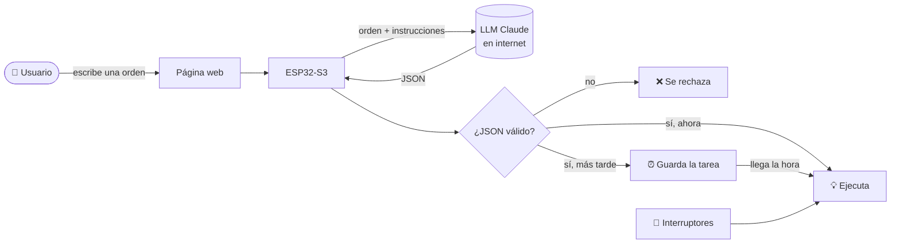

# 🏢 Agente ESP32-S3: automatización de una empresa con lenguaje natural

Proyecto final de **Inteligencia Artificial y Sistemas Embebidos**.

Un **ESP32-S3** recibe órdenes escritas en español, por ejemplo:

> «A las 8:00 p. m. enciende la luz de la entrada y los aspersores; avísame si alguna puerta está abierta.»

Un **modelo de lenguaje (LLM)** en internet traduce la orden a un **JSON**, y el ESP32
**revisa** ese JSON y lo **ejecuta**: enciende LED (luces y aspersores), vigila
interruptores (puertas y ventanas), programa tareas para más tarde y avisa cuando algo
pasa.

> 🔑 **Idea clave:** el LLM solo *interpreta* el texto. Quien *decide y actúa* es el ESP32,
> que solo acepta acciones de una lista permitida y revisa los sensores reales.

---

## 📋 Contenido

1. [¿Qué puede hacer?](#-qué-puede-hacer)
2. [¿Cómo funciona?](#-cómo-funciona)
3. [Materiales y conexiones](#-materiales-y-conexiones)
4. [Instalación paso a paso](#-instalación-paso-a-paso)
5. [Cómo usarlo](#️-cómo-usarlo)
6. [Archivos del proyecto](#-archivos-del-proyecto)
7. [¿Qué pasa si algo falla?](#-qué-pasa-si-algo-falla)
8. [Requisitos del taller](#-requisitos-del-taller)
9. [Documentación](#-documentación)

---

## ✨ ¿Qué puede hacer?

| Función | Ejemplo |
|---------|---------|
| 💡 Encender/apagar al instante | «Enciende la luz de la bodega» |
| ⏰ Programar a una hora | «A las 8:00 p. m. enciende los aspersores» |
| 🔁 Secuencias | «Enciende la oficina a las 6 p. m. y, quince minutos después, el parqueadero» |
| 🚪 Consultar puertas/ventanas | «¿Qué puertas o ventanas están abiertas?» |
| 🔀 Órdenes con condición | «Si todas las puertas están cerradas, apaga las luces» |
| 🔔 Alertas | «Avísame si alguna puerta está abierta» → aviso en la página + LED rojo |
| 📝 Ver y cancelar tareas | «¿Qué tareas quedaron programadas?» / botón *Cancelar* |
| ❓ Pedir aclaración | «Enciende los aspersores más tarde» → *¿A qué hora?* |
| 💾 Recordar tras reinicio | Las tareas se guardan en memoria y se recuperan al reiniciar |

## 🧠 ¿Cómo funciona?



1. Escribes la orden en la página web que muestra el propio ESP32.
2. El ESP32 la envía al LLM (Claude) por internet.
3. El LLM responde con un JSON como este:
   ```json
   {"tipo": "plan", "mensaje": "Encender luz de entrada a las 20:00",
    "acciones": [{"accion": "encender", "dispositivo": "luz_entrada", "hora": "20:00"}]}
   ```
4. El ESP32 lo **revisa**: ¿la acción está permitida?, ¿el dispositivo existe?, ¿la hora es válida?
   Si algo está mal, **no hace nada**.
5. Si está bien, lo ejecuta ya o lo guarda para la hora indicada.

Mientras tanto, el ESP32 vigila las puertas todo el tiempo (usa sus dos núcleos, así que
esperar al LLM no detiene nada).

➡️ Explicación completa para principiantes: **[docs/COMO_FUNCIONA.md](docs/COMO_FUNCIONA.md)**

## 🔧 Materiales y conexiones

- 1 ESP32-S3 · 7 LED (4 luces, 2 aspersores, 1 alerta) con resistencias de 220 Ω · 5 interruptores · protoboard y cables.

| Pin | Dispositivo | | Pin | Dispositivo |
|:--:|---|---|:--:|---|
| 4 | 💡 Luz de la entrada | | 8 | 🚪 Puerta principal |
| 5 | 💡 Luz de la oficina | | 9 | 🚪 Puerta de la bodega |
| 6 | 💡 Luz del parqueadero | | 10 | 🚪 Puerta de la oficina |
| 7 | 💡 Luz de la bodega | | 11 | 🪟 Ventana de la oficina |
| 15 | 💧 Aspersor frontal | | 12 | 🪟 Ventana de la recepción |
| 16 | 💧 Aspersor trasero | | 17 | 🔴 LED de alerta |

- **LED:** `pin → resistencia 220 Ω → LED → GND`
- **Interruptor:** `pin → interruptor → GND` · cerrado = puerta **cerrada**, abierto = puerta **abierta**

➡️ Diagramas y detalles: **[docs/CONEXIONES.md](docs/CONEXIONES.md)**

## 🚀 Instalación paso a paso

### 1. Preparar el Arduino IDE
1. Instala el [Arduino IDE 2](https://www.arduino.cc/en/software).
2. *Archivo → Preferencias → URLs adicionales de gestor de placas*, pega:
   `https://espressif.github.io/arduino-esp32/package_esp32_index.json`
3. *Herramientas → Placa → Gestor de placas*: instala **esp32** (de Espressif Systems).
   Versión probada: **2.0.17**.
4. *Herramientas → Gestionar bibliotecas*: instala **ArduinoJson** (de Benoit Blanchon), versión 7.

### 2. Descargar el proyecto
```bash
git clone https://github.com/MainRDSniper09/ESP32-IA.git
```
O en GitHub: botón verde *Code → Download ZIP*.

### 3. Poner tus claves
1. En la carpeta `AgenteESP32/`, copia `credenciales_ejemplo.h` y renómbralo a **`credenciales.h`**.
2. Ábrelo y escribe tu red Wi-Fi y tu clave de la API de Claude
   (se obtiene en [console.anthropic.com](https://console.anthropic.com)):
   ```cpp
   #define WIFI_NOMBRE  "MiRed"
   #define WIFI_CLAVE   "MiClave"
   #define LLM_API_KEY  "sk-ant-..."
   ```
   `credenciales.h` **no se sube a GitHub** (está en `.gitignore`).

### 4. Subir el programa
1. Abre `AgenteESP32/AgenteESP32.ino` en el Arduino IDE.
2. *Herramientas → Placa*: **ESP32S3 Dev Module**. Elige el puerto COM.
3. Pulsa **Subir** (→).
4. Abre el **Monitor Serie** a **115200** baudios. Verás algo como:
   ```
   === Agente ESP32-S3 ===
   Conectando a Wi-Fi.....
   Conectado. Abre en el navegador: http://192.168.1.60
   [aviso] Hora sincronizada por internet: 06/11 17:58
   ```
5. Abre esa dirección en el navegador (desde la misma red Wi-Fi).

> Si el ESP32 no encuentra tu red, crea la suya: conéctate a **Agente-ESP32**
> (clave `agente1234`) y abre **http://192.168.4.1**.

## 🖥️ Cómo usarlo

La página tiene cuatro partes:

- **Escribe una orden:** el cuadro de texto, botones con ejemplos y la respuesta del sistema
  (incluido el JSON que devolvió el LLM, para ver qué entendió).
- **Luces y aspersores:** estado de cada uno y botón para encender/apagar.
- **Puertas y ventanas:** abierta o cerrada, en tiempo real.
- **Tareas programadas** (con botón *Cancelar*) y **Avisos** (las alertas aparecen en rojo).

También se puede usar sin la página, desde cualquier programa, con la **API**:

```bash
curl -X POST http://192.168.1.60/api/orden -d "{\"texto\": \"Apaga todas las luces\"}"
curl -X POST http://192.168.1.60/api/plan -d @ejemplos/1_control_inmediato.json   # sin LLM
curl http://192.168.1.60/api/estado
```

➡️ Manual de la API (cada petición y respuesta JSON explicada): **[docs/API.md](docs/API.md)**
➡️ Formato del JSON y reglas de validación: **[docs/FORMATO_JSON.md](docs/FORMATO_JSON.md)**

## 📁 Archivos del proyecto

```
ESP32-IA/
├── AgenteESP32/                  ← el programa (se abre con Arduino IDE)
│   ├── AgenteESP32.ino           inicio: Wi-Fi, monitoreo y servidor web
│   ├── config.h                  pines, zona horaria, límites
│   ├── credenciales_ejemplo.h    plantilla de claves (cópiala como credenciales.h)
│   ├── dispositivos.h / .cpp     LED e interruptores
│   ├── plan.h / .cpp             revisar y ejecutar el JSON (acciones permitidas)
│   ├── tareas.h / .cpp           tareas programadas y memoria no volátil
│   ├── avisos.h / .cpp           notificaciones y LED de alerta
│   ├── llm.h / .cpp              conexión con Claude
│   ├── servidor_web.h / .cpp     página web y API
│   └── pagina_web.h              diseño de la página (HTML)
├── docs/                         ← documentación
├── ejemplos/                     ← planes JSON de prueba (válidos e inválidos)
├── README.md
└── LICENSE
```

## 🧯 ¿Qué pasa si algo falla?

| Situación | Qué hace el sistema |
|-----------|---------------------|
| **No hay Wi-Fi** | Crea su propia red (*Agente-ESP32*). La página, los botones, el monitoreo y las tareas siguen funcionando. Las órdenes escritas no (sin internet no hay LLM). |
| **Falla el LLM** | Muestra el error, genera una alerta y **no ejecuta nada**. Todo lo demás sigue igual. |
| **Se reinicia o se va la luz** | Arranca con todo apagado, **recupera las tareas** guardadas y las ejecuta a su hora. Si una tarea se pasó por más de 10 minutos, no la ejecuta tarde y avisa. |
| **Todavía no tiene la hora** | Acepta órdenes inmediatas, pero no programadas, hasta sincronizar la hora por internet. |
| **Orden ambigua** | Pregunta antes de guardar nada. |
| **JSON incorrecto** | Rechaza la orden completa y explica el error. |

## ✅ Requisitos del taller

| Requisito | Cómo se cumple |
|-----------|----------------|
| Interpretar intenciones, dispositivos, horarios, intervalos y condiciones | El LLM devuelve `accion`, `dispositivo`, `hora`, `minutos_despues`, `condicion` (`llm.cpp`) |
| Encender/apagar luces y aspersores (salidas digitales) | `dispositivos.cpp` |
| Consultar puertas y ventanas (entradas digitales) | `dispositivos.cpp`, acción `consultar_accesos` |
| Órdenes inmediatas, a una hora y secuencias sin bloquear | `tareas.cpp` + tarea de monitoreo en el núcleo 1 |
| Guardar tareas en memoria no volátil y recuperarlas | `tareas.cpp` (librería `Preferences`) |
| Alertas visibles | Página web + LED rojo (`avisos.cpp`) |
| Listar y cancelar tareas, ver el estado | Página web, `/api/estado`, `/api/cancelar`, acciones `listar_tareas` y `cancelar_tarea` |
| ESP32-S3, C++ en Arduino, Wi-Fi, LLM remoto | Todo el proyecto |
| Sin frameworks de agentes | Solo `WiFi`, `HTTPClient`, `WebServer`, `Preferences` y `ArduinoJson` |
| Catálogo explícito de funciones autorizadas | `ejecutarAccion()` en `plan.cpp` (6 acciones) |
| Validar esquema, tipos, dispositivos y horarios; rechazar acciones desconocidas | `procesarPlan()` en `plan.cpp` |
| NTP y zona horaria | `configTzTime()` en el `.ino`, zona en `config.h` |
| Comportamiento sin Wi-Fi, con falla de API y tras reinicio | Tabla anterior y [docs/COMO_FUNCIONA.md](docs/COMO_FUNCIONA.md) |
| Proteger las credenciales | `credenciales.h` fuera de GitHub; nunca se muestran en la página |
| Ambigüedad → aclaración | `esAmbigua()` + `"tipo": "aclaracion"` |
| Condiciones evaluadas con los sensores, no con el LLM | `condicionCumplida()` en `plan.cpp` |
| Informe de pruebas (ambigua/inválida y reinicio) | [docs/PRUEBAS.md](docs/PRUEBAS.md) |

## 📚 Documentación

| Documento | Contenido |
|-----------|-----------|
| [COMO_FUNCIONA.md](docs/COMO_FUNCIONA.md) | Explicación para principiantes, diagrama, fallos, qué hace cada archivo |
| [CONEXIONES.md](docs/CONEXIONES.md) | Materiales, pines y cómo conectar |
| [FORMATO_JSON.md](docs/FORMATO_JSON.md) | El JSON que usa el LLM y las reglas de validación |
| [API.md](docs/API.md) | Manual de la API: cada petición y respuesta |
| [PRUEBAS.md](docs/PRUEBAS.md) | Informe y lista de pruebas |

## 📄 Licencia

[MIT](LICENSE) — libre para usar, modificar y compartir. © 2026 Juan Nicolás Barreto Sánchez
