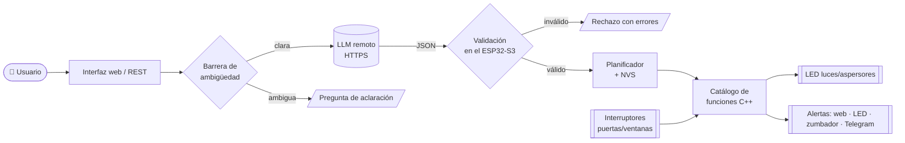

<div align="center">

# 🏢 Agente ESP32-S3 — Automatización y supervisión empresarial con LLM

**Órdenes en lenguaje natural → plan JSON validado → ejecución determinista en un microcontrolador**

[](https://github.com/MainRDSniper09/ESP32-IA/actions/workflows/ci.yml)


[](LICENSE)

*Proyecto integrador · Inteligencia Artificial y Sistemas Embebidos*

</div>

---

> «A las 8:00 p. m. enciende la luz de la entrada y los aspersores; avísame si alguna puerta está abierta.»

Este proyecto convierte una frase así en acciones **verificables** sobre un ESP32-S3:
un modelo de lenguaje (LLM) remoto interpreta la orden y devuelve un **JSON estructurado**;
el firmware lo **valida** contra un catálogo cerrado de funciones C++, lo **programa** sin
bloquear el sistema, lo **guarda** en memoria no volátil y lo **ejecuta** sobre LED (luces y
aspersores), evaluando las condiciones con interruptores reales (puertas y ventanas).

**El LLM nunca toca un pin.** Solo elige operaciones y parámetros; toda decisión con efecto
físico es código determinista en el microcontrolador.

## 📑 Contenido

- [Qué hace](#-qué-hace)
- [Arquitectura](#-arquitectura)
- [Inicio rápido](#-inicio-rápido)
- [Hardware](#-hardware)
- [Formato JSON](#-formato-json)
- [API REST](#-api-rest)
- [Comportamiento ante fallos](#-comportamiento-ante-fallos)
- [Pruebas](#-pruebas)
- [Estructura del repositorio](#-estructura-del-repositorio)
- [Cumplimiento del enunciado](#-cumplimiento-del-enunciado)
- [Documentación](#-documentación)
- [Contribuir y licencia](#-contribuir)

## ✨ Qué hace

| Capacidad | Detalle |
|-----------|---------|
| 🗣️ **Lenguaje natural** | Interfaz web (chat) o API REST. Interpreta intenciones, dispositivos, horas, intervalos y condiciones. |
| 💡 **Control** | 4 luces y 2 aspersores (LED) — individual o por grupo. |
| 🚪 **Monitoreo** | 3 puertas y 2 ventanas (interruptores) con antirrebote, cambios en tiempo real. |
| ⏰ **Planificación** | Inmediata, a una hora (`20:00`), con retardo, secuencias (`15 min después`), diaria. Sin bloquear. |
| 🔀 **Condiciones** | «si todas las puertas están cerradas», «si alguna está abierta»… evaluadas **con los sensores** al ejecutar. |
| 💾 **Persistencia** | Tareas en NVS; se recuperan y revalidan tras un reinicio. Tareas perdidas → alerta. |
| 🔔 **Alertas** | Aviso en la interfaz, LED rojo, zumbador y (opcional) Telegram. |
| ❓ **Ambigüedad** | «más tarde» → pide aclaración antes de guardar nada (barrera local + LLM). |
| 🛡️ **Validación** | Esquema, tipos, nombres, horarios; acciones desconocidas rechazadas; planes atómicos. |
| 🔌 **Robustez** | Sin Wi-Fi → punto de acceso local. Sin hora → solo órdenes inmediatas. LLM caído → nada se ejecuta. |
| 🔁 **Proveedor intercambiable** | Claude (por defecto) o cualquier API compatible con OpenAI, incluido Ollama local. |

## 🧭 Arquitectura



- **`core/`** — lógica pura en C++11 (validador, planificador, agente, prompt). No depende de Arduino: se prueba en el PC.
- **`platform/`** — adaptadores ESP32: GPIO, NTP, NVS, Wi-Fi, FreeRTOS, notificaciones.
- **`llm/`** y **`web/`** — cliente HTTPS del LLM y API REST + interfaz.

Dos tareas de FreeRTOS garantizan que **el monitoreo nunca se detiene**: `ioTask` (núcleo 1,
cada 10 ms) lee interruptores y ejecuta tareas vencidas; `net` (núcleo 0) espera al LLM.

➡️ Detalles, diagramas de secuencia y decisiones de diseño: **[docs/ARCHITECTURE.md](docs/ARCHITECTURE.md)**

## 🚀 Inicio rápido

```bash
git clone https://github.com/MainRDSniper09/ESP32-IA.git
cd ESP32-IA/firmware/AgenteESP32/src/config
cp agente_secrets.example.h agente_secrets.h     # y complete Wi-Fi + clave del LLM
cd ../../..                                      # vuelve a firmware/
pio run -e esp32s3 -t upload && pio device monitor
```

Abra **http://agente-esp32.local** (o la IP que imprime la consola) y escriba una orden.

| ¿Sin hardware? | ¿Arduino IDE? | ¿Sin clave de LLM? |
|---|---|---|
| Simúlelo en **Wokwi** con `firmware/diagram.json` | Abra `firmware/AgenteESP32/AgenteESP32.ino` | Use el control manual y `POST /api/plan` con los JSON de `examples/plans/` |

➡️ Guía paso a paso (PlatformIO, Arduino IDE, Wokwi, proveedores de LLM, zona horaria, problemas comunes): **[docs/SETUP.md](docs/SETUP.md)**

## 🔧 Hardware

| GPIO | Dispositivo | | GPIO | Dispositivo |
|:---:|---|---|:---:|---|
| 4 | 💡 `luz_entrada` | | 8 | 🚪 `puerta_principal` |
| 5 | 💡 `luz_oficina` | | 9 | 🚪 `puerta_bodega` |
| 6 | 💡 `luz_parqueadero` | | 10 | 🚪 `puerta_oficina` |
| 7 | 💡 `luz_bodega` | | 11 | 🪟 `ventana_oficina` |
| 15 | 💧 `aspersor_frontal` | | 12 | 🪟 `ventana_recepcion` |
| 16 | 💧 `aspersor_trasero` | | 17 / 18 / 21 | 🔴 LED alerta / 🔊 zumbador / 🟢 LED estado |

- **Salidas:** `GPIO → 220 Ω → LED → GND` (alto = encendido).
- **Entradas:** `GPIO → interruptor → GND` con *pull-up* interno. **Contacto cerrado = CERRADA**; abierto o cable suelto = ABIERTA (falla segura).

➡️ Lista de materiales, diagrama de conexiones y por qué se eligieron esos pines: **[docs/HARDWARE.md](docs/HARDWARE.md)**

## 🧾 Formato JSON

El LLM debe responder **solo** con este formato; el firmware lo valida campo por campo.

```json
{
  "version": 1,
  "type": "plan",
  "summary": "18:00 luz de oficina; 15 min después luz del parqueadero",
  "steps": [
    { "action": "set_device", "params": { "device": "luz_oficina", "state": "on" },
      "when": { "type": "at", "time": "18:00" } },
    { "action": "set_device", "params": { "device": "luz_parqueadero", "state": "on" },
      "when": { "type": "after_step", "step": 0, "seconds": 900 } }
  ]
}
```

| Elemento | Opciones |
|----------|----------|
| `type` | `plan` · `clarification` (con `question`) · `unsupported` |
| `action` | `set_device` · `set_group` · `notify` · `read_access` · `list_tasks` · `cancel_task` · `system_status` |
| `when` | `now` · `at` (`HH:MM`, `date`, `repeat:"daily"`) · `delay` (`seconds`) · `after_step` (`step`, `seconds`) |
| `condition` | `all_closed` · `any_open` · `is_open` · `is_closed` sobre `doors` · `windows` · `accesses` · id |

➡️ Especificación completa, catálogo de códigos de error y los 4 escenarios del enunciado: **[docs/JSON_FORMAT.md](docs/JSON_FORMAT.md)** · Esquema: [`docs/schema/plan.schema.json`](docs/schema/plan.schema.json) · Ejemplos: [`examples/plans/`](examples/plans)

## 🌐 API REST

| Método | Ruta | Descripción |
|--------|------|-------------|
| `POST` | `/api/command` | Instrucción en lenguaje natural → `202 {job_id}` |
| `GET` | `/api/jobs?id=N` | Resultado de la instrucción (plan, pasos, errores, salida del LLM) |
| `POST` | `/api/plan` · `/api/plan/validate` | Ejecutar / validar un plan JSON sin LLM |
| `GET` | `/api/status` · `/api/devices` · `/api/accesses` · `/api/catalog` | Consultas |
| `POST` | `/api/devices/set` | Control manual |
| `GET` / `DELETE` | `/api/tasks` | Listar / cancelar tareas |
| `GET` / `POST` | `/api/events` · `/api/events/ack` | Eventos y alertas |

```bash
curl -X POST http://agente-esp32.local/api/command -H "Content-Type: application/json" \
     -d '{"text":"Revisa las puertas y, si todas están cerradas, apaga todas las luces"}'
# {"job_id":3,"status":"queued","poll":"/api/jobs?id=3"}
```

O con el cliente incluido: `python tools/agent_cli.py say "Apaga todas las luces"`.

➡️ Manual completo con cada ruta, cuerpos, respuestas, códigos de error y ejemplos en curl/Python/JS: **[docs/API.md](docs/API.md)**

## 🧯 Comportamiento ante fallos

| Situación | Resultado |
|-----------|-----------|
| **Sin Wi-Fi** | Punto de acceso `Agente-ESP32` (192.168.4.1): interfaz, control manual y tareas siguen funcionando; el LLM no. |
| **Sin hora (NTP)** | Solo se aceptan órdenes inmediatas; las tareas esperan a sincronizar. |
| **Falla el LLM** | 1 reintento; si persiste, error explícito y **nada se ejecuta**. El resto del sistema sigue. |
| **Reinicio** | Salidas apagadas; tareas recuperadas de NVS y revalidadas; vencidas hace > 10 min → alerta, no se ejecutan. |

➡️ **[docs/OPERACION_Y_FALLOS.md](docs/OPERACION_Y_FALLOS.md)**

## 🧪 Pruebas

```bash
cd firmware && pio test -e native      # 23 pruebas unitarias del núcleo en el PC
```

Cubren: operaciones válidas, rechazo de JSON/parámetros incorrectos, instrucciones ambiguas,
condiciones con sensores reales, secuencias, cancelación, **recuperación tras reinicio** y
tareas perdidas. GitHub Actions compila el firmware y ejecuta las pruebas en cada *push*.

➡️ Informe de pruebas y protocolo de integración en el prototipo: **[docs/TESTING.md](docs/TESTING.md)**

## 📁 Estructura del repositorio

```
ESP32-IA/
├── firmware/
│   ├── platformio.ini                 # entornos esp32s3 y native (pruebas)
│   ├── diagram.json · wokwi.toml      # simulación en Wokwi
│   ├── AgenteESP32/                   # carpeta del sketch (también abre en Arduino IDE)
│   │   ├── AgenteESP32.ino            # composición: componentes + tareas FreeRTOS
│   │   └── src/
│   │       ├── config/                # Pins.h · AppConfig.h · agente_secrets.example.h
│   │       ├── core/                  # lógica pura: Agent, PlanValidator, TaskScheduler,
│   │       │                          #   ActionCatalog, DeviceCatalog, PromptBuilder, EventLog...
│   │       ├── platform/              # Esp32Hardware, Esp32Services (NTP/NVS/mutex),
│   │       │                          #   NetworkManager, JobManager, Notifiers
│   │       ├── llm/                   # LlmClient (HTTPS)
│   │       └── web/                   # WebApi (REST) · WebPage.h (generado)
│   └── test/test_core/                # pruebas unitarias (Unity)
├── web/index.html                     # fuente de la interfaz web
├── docs/                              # arquitectura, API, JSON, hardware, setup, fallos, pruebas, demo
├── examples/plans/                    # planes JSON válidos e inválidos
├── tools/                             # build_web.py · validate_examples.py · agent_cli.py
└── .github/                           # CI, plantillas de issues y PR
```

## ✅ Cumplimiento del enunciado

| Requisito | Dónde |
|-----------|-------|
| Interpretación (intenciones, dispositivos, horarios, intervalos, condiciones) | `core/PromptBuilder.cpp`, `core/PlanValidator.cpp` |
| Control de luces y aspersores (salidas digitales) | `core/Agent.cpp` (`doSetDevice`, `doSetGroup`), `platform/Esp32Hardware.cpp` |
| Monitoreo de puertas/ventanas (entradas digitales) | `platform/Esp32Hardware.cpp` (antirrebote), `Agent::doReadAccess` |
| Planificación inmediata / horaria / secuencias sin bloquear | `core/TaskScheduler.cpp`, `ioTask` en `AgenteESP32.ino` |
| Persistencia en memoria no volátil y recuperación tras reinicio | `platform/Esp32Services.cpp` (NVS), `Agent::begin` |
| Alertas visibles / canal de mensajería | `core/EventLog.cpp`, `platform/Notifiers.cpp`, interfaz web |
| Listar, cancelar tareas, consultar estado | `/api/tasks`, acciones `list_tasks`, `cancel_task`, `system_status` |
| ESP32-S3 + C++ Arduino + Wi-Fi + LLM remoto | `platformio.ini`, `llm/LlmClient.cpp` |
| Sin frameworks de agentes ni *tool calling* | Solo `HTTPClient`, `WiFiClientSecure`, `ArduinoJson`, `Preferences`, `WebServer` |
| Catálogo explícito de funciones autorizadas | `core/ActionCatalog.cpp` + `Agent::do*` |
| Validar esquema, tipos, dispositivos y horarios; rechazar acciones desconocidas | `core/PlanValidator.cpp` |
| NTP + zona horaria; comportamiento sin Wi-Fi, falla de API, reinicio | `Esp32Clock`, `AppConfig.h`, [OPERACION_Y_FALLOS.md](docs/OPERACION_Y_FALLOS.md) |
| Credenciales protegidas | `agente_secrets.h` en `.gitignore`, [SECURITY_NOTES.md](docs/SECURITY_NOTES.md) |
| Ambigüedad → aclaración antes de guardar | `text::findAmbiguousTime`, `type: clarification` |
| Condicionales evaluadas localmente con sensores | `Agent::evaluate` |
| Entregables: código, diagrama, formato JSON, pruebas, guion del video | Este repositorio · [ARCHITECTURE](docs/ARCHITECTURE.md) · [JSON_FORMAT](docs/JSON_FORMAT.md) · [TESTING](docs/TESTING.md) · [DEMO](docs/DEMO.md) |

## 📚 Documentación

| Documento | Contenido |
|-----------|-----------|
| [ARCHITECTURE.md](docs/ARCHITECTURE.md) | Capas, diagramas, concurrencia, decisiones de diseño, cómo extender |
| [API.md](docs/API.md) | Manual de la API REST (Request/Response JSON) |
| [JSON_FORMAT.md](docs/JSON_FORMAT.md) | Contrato LLM ↔ firmware, reglas de validación |
| [HARDWARE.md](docs/HARDWARE.md) | Materiales, pines, conexiones |
| [SETUP.md](docs/SETUP.md) | Instalación, configuración, compilación, simulación |
| [OPERACION_Y_FALLOS.md](docs/OPERACION_Y_FALLOS.md) | Sin Wi-Fi, falla de API, reinicio |
| [TESTING.md](docs/TESTING.md) | Informe y protocolo de pruebas |
| [SECURITY_NOTES.md](docs/SECURITY_NOTES.md) | Credenciales, TLS, el LLM como entrada no confiable |
| [DEMO.md](docs/DEMO.md) | Guion del video de demostración |

## 🤝 Contribuir

Las contribuciones son bienvenidas: lea **[CONTRIBUTING.md](CONTRIBUTING.md)** y el
[Código de conducta](CODE_OF_CONDUCT.md). Para vulnerabilidades, ver [SECURITY.md](SECURITY.md).

## 📄 Licencia

[MIT](LICENSE) © 2026 Juan Nicolás Barreto Sánchez
