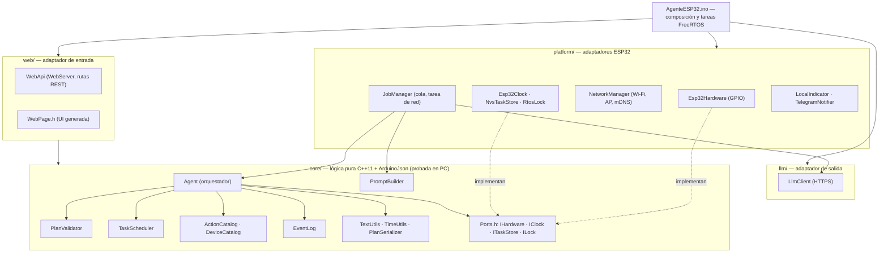
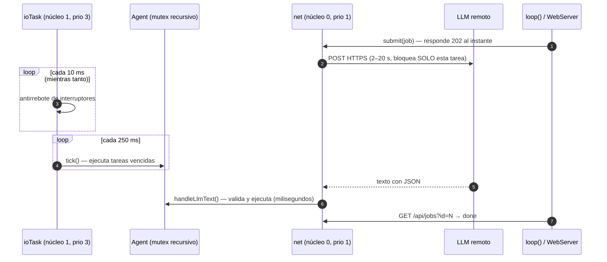
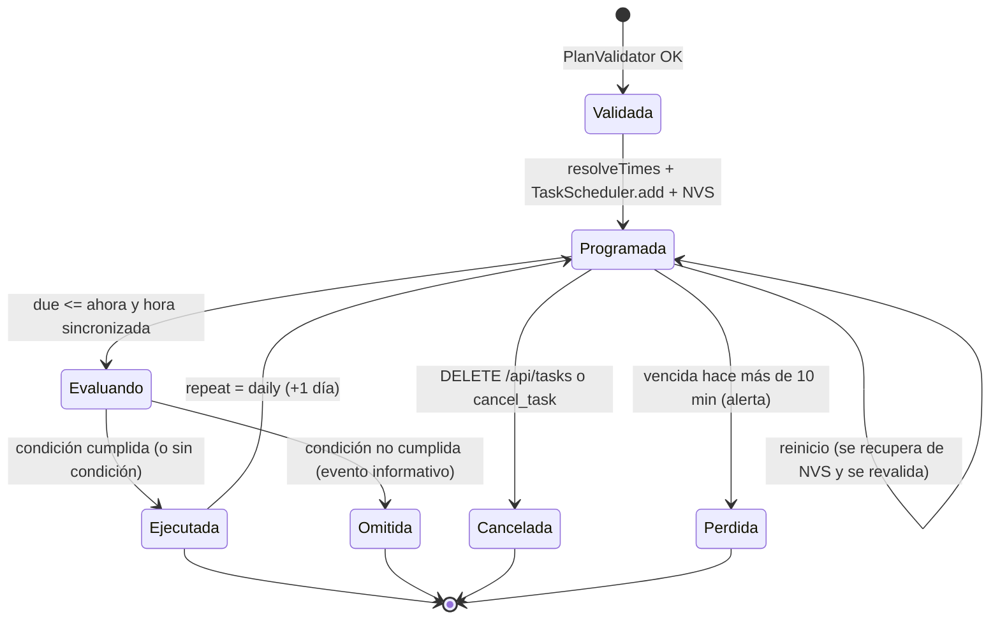

# Arquitectura

> **Idea central:** el LLM *interpreta*; el firmware *decide y ejecuta*.
> El modelo de lenguaje solo convierte español en un JSON con operaciones de un catálogo
> cerrado. Todo lo que tiene consecuencias físicas (validar, programar, evaluar condiciones,
> encender un LED) es código C++ determinista que corre en el ESP32-S3.

## 1. Flujo funcional

Corresponde a la arquitectura pedida en el enunciado:
*Usuario → interfaz → LLM → JSON → validación → planificador/almacenamiento → funciones C++ → LED, interruptores y notificaciones.*

```mermaid
flowchart LR
    U([👤 Usuario]) -->|texto en español| UI[Interfaz web<br/>o cliente REST]
    UI -->|POST /api/command| JM[JobManager<br/>cola + tarea de red]
    JM --> G{Barrera de<br/>ambigüedad}
    G -->|"«más tarde»"| CL[/clarification/]
    G -->|ok| P[PromptBuilder<br/>catálogo + hora local]
    P -->|HTTPS| LLM[(LLM remoto<br/>Claude / OpenAI-compat)]
    LLM -->|texto con JSON| X[extractJsonObject]
    X --> V{PlanValidator<br/>esquema · tipos ·<br/>dispositivos · horarios}
    V -->|inválido| RJ[/rejected + errores/]
    V -->|Plan tipado| R[resolveTimes<br/>HH:MM → epoch]
    R -->|inmediato| E[Agent::executeStep]
    R -->|futuro| S[(TaskScheduler<br/>+ NVS)]
    S -->|tick cada 250 ms| E
    E --> C{Condición<br/>con sensores reales}
    C -->|no se cumple| SK[/skipped/]
    C -->|se cumple| F[Catálogo de funciones C++<br/>doSetDevice · doSetGroup · doNotify ...]
    F --> HW[[LED luces/aspersores]]
    F --> N[[EventLog → LED alerta,<br/>zumbador, web, Telegram]]
    SW[[Interruptores<br/>puertas/ventanas]] -->|antirrebote| C
```

## 2. Capas y dependencias

El código está organizado como una **arquitectura hexagonal (puertos y adaptadores)**.
El núcleo no conoce el hardware: depende de interfaces (`Ports.h`) que la capa de
plataforma implementa. Gracias a esto, **todo el núcleo se prueba en un PC** con dobles de prueba.

| Carpeta | Responsabilidad | ¿Depende de Arduino? |
|---------|-----------------|:---:|
| `src/config/` | Pines, parámetros, credenciales | Solo `Pins.h` (no) |
| `src/core/` | Dominio: validación, planificación, ejecución, prompt | **No** |
| `src/platform/` | GPIO, NTP, NVS, Wi-Fi, FreeRTOS, notificaciones | Sí |
| `src/llm/` | Cliente HTTP del LLM | Sí |
| `src/web/` | API REST e interfaz | Sí |

### Archivos del núcleo

| Archivo | Qué hace |
|---------|----------|
| `Types.h` | Estructuras del dominio: `Plan`, `PlanStep`, `Action`, `Timing`, `Condition`, `ScheduledTask`, `Event`. |
| `Ports.h` | Interfaces hacia el hardware (`IHardware`, `IClock`, `ITaskStore`, `ILock`). |
| `DeviceCatalog.*` | Tabla de dispositivos (id, nombre, tipo, pin) y grupos. **Única fuente de verdad.** |
| `ActionCatalog.*` | Tabla de acciones autorizadas con la especificación de sus parámetros. |
| `PlanValidator.*` | Convierte JSON no confiable en un `Plan` tipado o en una lista de errores. |
| `TaskScheduler.*` | Lista de tareas pendientes, extracción de vencidas, repetición diaria, (de)serialización. |
| `Agent.*` | Orquestador: resuelve horarios, ejecuta/programa, evalúa condiciones, persiste, registra eventos. |
| `PromptBuilder.*` | Genera el prompt del LLM a partir de los catálogos. |
| `EventLog.*` | Registro circular de eventos/alertas con ids crecientes. |
| `TextUtils.*` | Normalización del español, extracción de JSON, detección de horarios ambiguos. |
| `TimeUtils.*` | `HH:MM`, fechas, zona horaria, ISO 8601. |
| `PlanSerializer.*` | Plan → JSON canónico y → frases en español. |

## 3. Concurrencia (FreeRTOS)

El requisito «programar acciones **sin detener el monitoreo de entradas**» se cumple
separando el trabajo en tareas de FreeRTOS en los dos núcleos del ESP32-S3:

| Tarea | Núcleo | Prioridad | Periodo | Puede bloquearse |
|-------|:------:|:---------:|---------|:---:|
| `ioTask` | 1 | 3 | 10 ms (entradas), 250 ms (planificador) | **Nunca** |
| `loop()` (Arduino) | 1 | 1 | continuo | No (servidor web no bloqueante) |
| `net` (JobManager) | 0 | 1 | por evento | Sí (HTTPS al LLM / Telegram) |

**Sincronización:** el `Agent` se protege con un mutex recursivo (`RtosLock`). Las secciones
críticas son cortas (validar y ejecutar un plan toma milisegundos); la llamada HTTPS se hace
**fuera** del mutex. Los callbacks de eventos solo encolan (Telegram) o marcan una bandera
(zumbador), nunca bloquean.

## 4. Decisiones de diseño

| Decisión | Motivo |
|----------|--------|
| **Catálogo cerrado** de 7 acciones, cada una una función C++ (`Agent::do*`) | El LLM nunca ejecuta código ni toca pines; solo elige operaciones y parámetros. |
| **Validación estricta** (claves desconocidas, tipos exactos, rangos) | El JSON del LLM es entrada no confiable; preferimos rechazar a adivinar. |
| **Plan atómico** | Si un paso es inválido no se ejecuta ninguno: evita estados a medias. |
| **Condiciones evaluadas al ejecutar**, con los sensores | El LLM no conoce el estado real; la decisión es local y verificable. |
| **Barrera de ambigüedad local** antes del LLM | Defensa en profundidad: «más tarde» pide aclaración aunque el modelo invente una hora. Ahorra una llamada. |
| **Horarios resueltos a epoch al aceptar** | Las secuencias (`after_step`) quedan fijadas y sobreviven a reinicios. |
| **Persistencia en NVS + revalidación al cargar** | Las tareas sobreviven a reinicios; datos corruptos no se ejecutan. |
| **Tareas vencidas > 10 min = perdidas** | No encender aspersores a las 3 a. m. porque la luz volvió tarde. Se genera alerta. |
| **API asíncrona (jobs)** | El LLM es lento; el servidor web y el monitoreo nunca esperan. |
| **Prompt generado de los catálogos** | Agregar un dispositivo no requiere tocar el prompt ni el validador. |
| **Proveedor de LLM intercambiable** | Claude por defecto; cualquier API compatible con OpenAI (incluido Ollama local) como alternativa. |
| **Sin frameworks de agentes ni *tool calling*** | Requisito del enunciado: solo `HTTPClient` + `ArduinoJson`. |
| **Núcleo en C++11** | Compila con el estándar del core Arduino-ESP32 2.x (gnu++11) y con estándares posteriores. |

## 5. Ciclo de vida de una tarea programada

## 6. Uso de memoria (compilación de referencia)

`pio run -e esp32s3` (core Arduino-ESP32 2.0.17, partición `huge_app.csv`):

| Recurso | Uso |
|---------|-----|
| RAM estática | ~49 KB de 320 KB (15 %) |
| Flash (aplicación) | ~1,08 MB de 3 MB (34 %) |
| Heap durante una llamada HTTPS | ~45 KB adicionales (TLS) |

## 7. Cómo extender el sistema

- **Agregar un dispositivo:** pin en `config/Pins.h` + fila en `kDevices[]` (`core/DeviceCatalog.cpp`). Listo.
- **Agregar una acción:** valor en `ActionId` (`Types.h`), fila en `kActions[]` con sus parámetros
  (`ActionCatalog.cpp`), validación semántica en `PlanValidator::validateParams`, implementación
  `Agent::doX` + `case` en `Agent::executeStep`, texto en `PlanSerializer`. Agregar pruebas.
- **Otro canal de notificación:** suscribirse en `onEvent()` (`AgenteESP32.ino`) y encolar el envío
  en la tarea de red, como hace `TelegramNotifier`.
