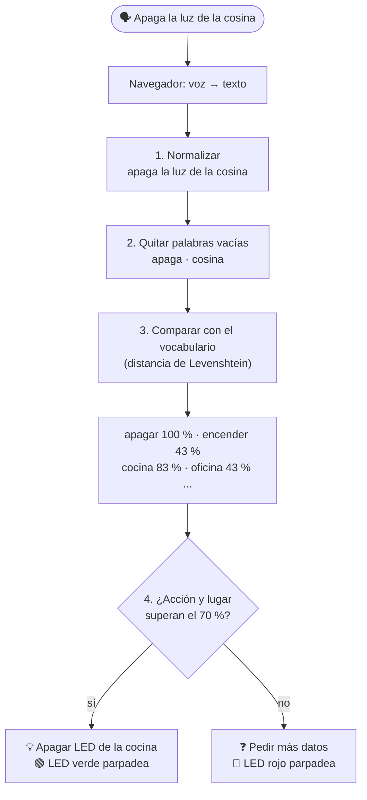

# ¿Cómo funciona el asistente? (explicado paso a paso)

Este documento explica cómo la ESP32 **entiende** una orden como «apaga la luz de la cocina»
sin usar internet ni una inteligencia artificial externa. Todo el código está en la
**sección 5** de `AgenteESP32/AgenteESP32.ino` (con ayudantes en las secciones 3 y 4).

## 1. El recorrido completo



## 2. Paso 1 — Voz a texto

El reconocimiento de voz (convertir el sonido en palabras) lo hace **el navegador** con la
*Web Speech API* de Google Chrome. La ESP32 recibe solo el **texto**. Así la ESP32 se dedica
a lo importante para el proyecto: **interpretar** ese texto.

El reconocimiento de voz a veces se equivoca: escribe «cosina» en vez de «cocina», o
«ensiende» en vez de «enciende». Por eso el intérprete no busca palabras exactas, sino
**parecidas**.

## 3. Paso 2 — Limpiar el texto

Función `normalizar()` (sección 4):

| Antes | Después |
|-------|---------|
| `¡Apaga la Luz de la Cocina!` | `apaga la luz de la cocina` |
| `Enciende la luz del baño` | `enciende la luz del bano` |

- Todo a minúsculas.
- Sin tildes (á→a, ñ→n).
- Los signos (¿?¡!,.) se vuelven espacios.

Función `separarPalabras()`: divide en palabras y descarta las **palabras vacías**, que no
cambian el significado: *el, la, de, del, luz, luces, por, favor, oye, asistente...*
(lista `PALABRAS_VACIAS`, sección 3).

```
"apaga la luz de la cocina"   →   apaga · cocina
```

## 4. Paso 3 — El porcentaje de parecido (Levenshtein)

La **distancia de Levenshtein** cuenta el **mínimo número de letras** que hay que cambiar,
agregar o quitar para convertir una palabra en otra:

| Palabra dicha | Palabra conocida | Cambios | Explicación |
|---------------|------------------|:--:|-------------|
| cocina | cocina | 0 | idénticas |
| cosina | cocina | 1 | s → c |
| ensiende | enciende | 1 | s → c |
| vodega | bodega | 1 | v → b |
| oficina | cocina | 3 | muy distintas |

Con esa distancia se calcula el **porcentaje de parecido** (función `parecido()`):

```
porcentaje = (1 − cambios ÷ letras de la palabra más larga) × 100

cosina vs cocina   →  (1 − 1/6) × 100 = 83 %
ensiende vs enciende → (1 − 1/8) × 100 = 88 %
oficina vs cocina  →  (1 − 3/7) × 100 = 57 %
```

Para cada concepto (encender, apagar, todas y cada habitación), el asistente busca **entre
todas las palabras dichas** cuál se parece más a alguna de sus palabras conocidas
(`mejorParecido()`). Ese es el porcentaje que aparece en la tabla.

## 5. Paso 4 — La decisión

El **umbral** es **70 %** (constante `UMBRAL`, sección 3). Por debajo de eso se considera que
la palabra no corresponde.

1. **¿Qué hacer?** La acción con mayor porcentaje entre *encender* y *apagar*, si supera el 70 %.
2. **¿Dónde?**
   - Si «todas», «todo» o «general» supera el 70 % → **todas** las habitaciones.
   - Si no, **cada** habitación que supere el 70 %. Pueden ser varias: «la cocina y la oficina».
   - Si no nombró ninguna pero dijo «luces» (plural) → **todas** («apaga las luces»).
3. **Confianza** = promedio entre el % de la acción y el % de los lugares elegidos.
4. **Resultado:**

| Caso | Respuesta | LED |
|------|-----------|-----|
| Acción ✅ y lugar ✅ | «Listo: apagué la luz de: Cocina» y cambia el LED | 🟢 verde parpadea |
| Acción ✅, lugar ❌ | «Entendí que quieres encender, pero no en qué lugar» | 🔴 rojo |
| Acción ❌, lugar ✅ | «Entendí el lugar, pero no si quieres encender o apagar» | 🔴 rojo |
| Nada | «No entendí la orden...» | 🔴 rojo |

## 6. Ejemplos reales del intérprete

Resultados obtenidos con el mismo código de las secciones 2 a 5:

| Orden | Encender | Apagar | Lugar ganador | Decisión | Confianza |
|-------|:--:|:--:|---------------|----------|:--:|
| Apaga la luz de la cocina | 50 % | **100 %** | Cocina **100 %** | apagar Cocina | 100 % |
| apaga la cosina | 43 % | **100 %** | Cocina **83 %** | apagar Cocina | 91 % |
| Enciende la oficina y la recepción | **100 %** | 33 % | Oficina **100 %**, Recepción **100 %** | encender ambas | 100 % |
| prende todas las luces | **100 %** | 20 % | Todas **100 %** | encender todas | 100 % |
| apaga las luces | 33 % | **100 %** | (dijo «luces») | apagar todas | 100 % |
| ensiende el despacho | **88 %** | 44 % | Oficina **100 %** (despacho) | encender Oficina | 94 % |
| apaga la vodega | 33 % | **100 %** | Bodega **83 %** | apagar Bodega | 91 % |
| desactiva el almacén | 67 % | **100 %** | Bodega **100 %** (almacén) | apagar Bodega | 100 % |
| enciende la luz | **100 %** | 20 % | ninguna (máx. 38 %) | ❓ pregunta dónde | 50 % |
| la cocina | 50 % | 50 % | Cocina **100 %** | ❓ pregunta qué hacer | 75 % |
| hola como estas | 29 % | 40 % | ninguna (máx. 57 %) | ❓ no entendió | 20 % |

## 7. «Entrenar» al asistente con palabras nuevas

El conocimiento del asistente está en listas de palabras (sección 3 y sección 2 del código).
Para que entienda una forma nueva de hablar, **agrega la palabra** a la lista
(en minúscula y sin tildes) y vuelve a subir el programa.

**Ejemplo:** que entienda «alumbra la cocina» como encender:

```cpp
const char* PALABRAS_ENCENDER[] = {
  "enciende", "encender", ..., "ilumina", "iluminar",
  "alumbra", "alumbrar",          // ← nuevas
  nullptr
};
```

**Ejemplo:** que «cuarto de aseo» se entienda como el baño:

```cpp
{"Baño", 15, {"bano", "banos", "sanitario", "aseo"}},   // ← "aseo" agregado (máximo 5 palabras)
```

**Agregar una habitación nueva:** conecta otro LED (por ejemplo al GPIO 21) y agrega una fila:

```cpp
{"Pasillo", 21, {"pasillo", "corredor"}},
```

La página web, la tabla de porcentajes y la API la incluyen automáticamente.

**Ajustar la tolerancia:** `UMBRAL = 70`. Si se confunde entre palabras, súbelo (80). Si no
entiende cuando el reconocimiento se equivoca, bájalo (60).

## 8. Limitaciones de esta parte 1

- Una orden = **una acción**. «Enciende la cocina y apaga la oficina» todavía no se separa en dos.
- No entiende negaciones («no apagues la cocina» apagaría la cocina).
- El reconocimiento de voz depende del navegador (Chrome) y del micrófono.

## 9. Sin internet

La interpretación **no necesita internet**: ocurre completa dentro de la ESP32.

- **Sin Wi-Fi:** la ESP32 crea su propia red **Asistente-ESP32** (clave `asistente123`).
  La página queda en `http://192.168.4.1`.
- **Desde el Monitor Serie:** puedes escribir órdenes y funciona sin ninguna red.
- **Ojo:** el reconocimiento de **voz** de Chrome sí usa internet en el celular o PC.
  Sin internet, escribe la orden en lugar de hablarla.
