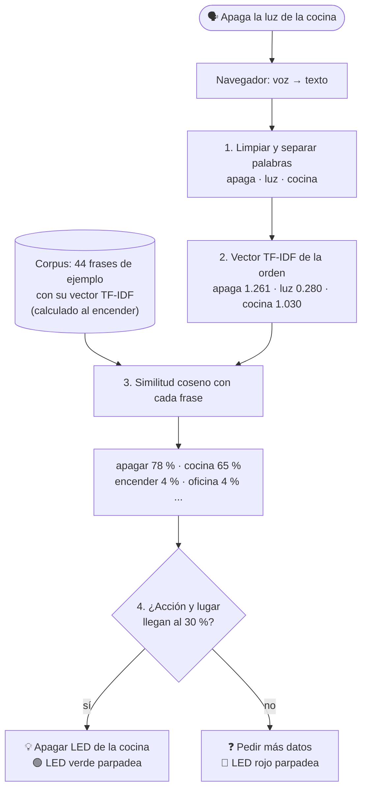

# ¿Cómo funciona el asistente? El algoritmo TF-IDF paso a paso

Este documento explica cómo la ESP32 **entiende** una orden como «apaga la luz de la cocina»
sin internet ni inteligencia artificial externa, usando el algoritmo **TF-IDF**.

Todo el código está en `AgenteESP32/AgenteESP32.ino`:

| Sección | Qué hay |
|:--:|---------|
| 3 | El **corpus**: las frases de ejemplo con su significado |
| 4 | Preparar el texto: `normalizar()`, `separarPalabras()`, `contarVeces()` |
| 5 | **TF-IDF**: `construirVocabulario()`, `calcularIDF()`, `calcularVectorTFIDF()`, `similitudCoseno()`, `entrenarModelo()` |
| 6 | El **intérprete**: `interpretar()` decide qué hacer y dónde |

---

## 1. La idea en una frase

> Cada frase se convierte en una **lista de números** (un *vector*) que dice cuánto pesa
> cada palabra. Después se mide qué tan **parecidos** son los vectores de la orden y de las
> frases conocidas. La frase conocida más parecida dice qué quiso el usuario.



---

## 2. Vocabulario básico

| Término | Qué es | En este proyecto |
|---------|--------|------------------|
| **Documento** | Un texto | Cada frase de ejemplo del corpus, por ejemplo «apaga la luz» |
| **Corpus** | El conjunto de todos los documentos | La tabla `CORPUS[]` (44 frases) |
| **Intención** | Lo que significa un documento | `encender`, `apagar`, `todas` o una habitación (`cocina`...) |
| **Vocabulario** | Todas las palabras distintas del corpus | 42 palabras |
| **Vector** | Una lista de números, uno por palabra del vocabulario | 42 números por frase |
| **Consulta** | El texto que queremos entender | La orden del usuario |

---

## 3. El corpus («los datos de entrenamiento»)

El asistente aprende de **ejemplos**. Cada fila del corpus es una frase y lo que significa
(sección 3 del código):

```cpp
const Documento CORPUS[] = {
  {"enciende la luz",            "encender"},
  {"prende la luz",              "encender"},
  ...
  {"apaga la luz",               "apagar"},
  {"desactiva la luz",           "apagar"},
  ...
  {"todas las luces",            "todas"},
  {"las luces",                  "todas"},
  ...
  {"luz de la cocina",           "cocina"},
  {"cocina",                     "cocina"},
  {"cafetería",                  "cocina"},
  ...
};
```

Las intenciones de las habitaciones coinciden con la segunda columna de la tabla
`HABITACIONES` (sección 2), así el programa sabe qué LED corresponde a cada una.

---

## 4. Paso 1 — Preparar el texto

**`normalizar()`** deja el texto en un formato único:

| Antes | Después |
|-------|---------|
| `¡Apaga la Luz de la Cocina!` | `apaga la luz de la cocina` |
| `Enciende la luz del baño` | `enciende la luz del bano` |

- Todo a minúsculas.
- Sin tildes (á→a, ñ→n).
- Los signos (¿?¡!,.) se vuelven espacios.

**`separarPalabras()`** parte el texto en palabras y quita las **palabras vacías**
(*el, la, de, del, y, por, favor, oye, asistente...*, lista `PALABRAS_VACIAS`), que aparecen
en cualquier frase y no dicen nada:

```
"apaga la luz de la cocina"   →   [apaga, luz, cocina]
```

> «luz» **no** es palabra vacía: se deja a propósito para que el **IDF** demuestre que, al
> aparecer en muchas frases, casi no pesa (ver paso 3).

---

## 5. Paso 2 — TF: frecuencia del término

**TF** mide qué tan frecuente es una palabra **dentro de una frase**:

```
TF(palabra) = veces que aparece la palabra en la frase / total de palabras de la frase
```

Para la orden `[apaga, luz, cocina]` (3 palabras):

| Palabra | Veces | TF |
|---------|:--:|:--:|
| apaga | 1 | 1/3 = **0.333** |
| luz | 1 | 1/3 = **0.333** |
| cocina | 1 | 1/3 = **0.333** |

Si la orden fuera «cocina cocina apaga», «cocina» tendría TF = 2/3.

En el código, dentro de `calcularVectorTFIDF()`:

```cpp
tf = (float)contarVeces(palabras, total, vocabulario[i]) / total;
```

---

## 6. Paso 3 — IDF: frecuencia inversa de documento

**IDF** mide qué tan **rara** es una palabra en **todo el corpus**:

```
IDF(palabra) = log( total de documentos / documentos que contienen la palabra )
```

(`log` es el logaritmo natural, el de la tecla *ln* de la calculadora.)

- Una palabra que está en **muchas** frases no sirve para distinguir → IDF **bajo**.
- Una palabra que está en **pocas** frases identifica muy bien el tema → IDF **alto**.

Con el corpus de 44 frases:

| Palabra | Documentos que la tienen | IDF = log(44 / docs) | ¿Qué significa? |
|---------|:--:|:--:|------------------|
| luz | 19 | log(44/19) = **0.840** | Está en casi la mitad: pesa poco |
| sala | 3 | log(44/3) = **2.686** | Bastante rara |
| cocina | 2 | log(44/2) = **3.091** | Rara: pesa mucho |
| apaga | 1 | log(44/1) = **3.784** | La más rara posible: pesa al máximo |

Por eso «luz» casi no influye en la decisión, aunque esté en la orden. Ese es el aporte
principal de TF-IDF: **las palabras comunes pesan poco y las distintivas pesan mucho**.

En el código (`calcularIDF()`):

```cpp
idf[i] = log((float)NUM_DOCUMENTOS / documentos);
```

> El IDF se calcula **una sola vez**, al encender la ESP32. Lo puedes ver completo en el
> Monitor Serie al arrancar y en la sección «📚 Modelo entrenado» de la página web.

---

## 7. Paso 4 — TF-IDF: el peso final de cada palabra

```
TF-IDF = TF × IDF
```

Orden «apaga la luz de la cocina»:

| Palabra | TF | IDF | TF-IDF |
|---------|:--:|:--:|:--:|
| apaga | 0.333 | 3.784 | **1.261** |
| luz | 0.333 | 0.840 | **0.280** |
| cocina | 0.333 | 3.091 | **1.030** |

El **vector** de la orden tiene 42 casillas (una por palabra del vocabulario). Solo 3 son
distintas de cero:

```
            apaga  luz    cocina  enciende  oficina  ... (las demás)
orden   = [ 1.261, 0.280, 1.030,  0,        0,       ... 0 ]
```

Lo mismo se hace con **cada frase del corpus** (en `entrenarModelo()`):

| Frase del corpus | Palabras | Vector (casillas distintas de 0) |
|------------------|----------|-----------------------------------|
| «apaga la luz» | apaga, luz | apaga = ½ × 3.784 = **1.892** · luz = ½ × 0.840 = **0.420** |
| «luz de la cocina» | luz, cocina | luz = **0.420** · cocina = ½ × 3.091 = **1.546** |
| «luz de la oficina» | luz, oficina | luz = **0.420** · oficina = **1.546** |

Una palabra que no está en el corpus (por ejemplo «hola») no tiene casilla en el vector:
se **ignora**.

---

## 8. Paso 5 — Similitud coseno: el porcentaje

Para saber qué tan parecidos son dos vectores **A** (la orden) y **B** (una frase del
corpus) se usa la **similitud coseno**:

```
              A · B              suma de A[i] × B[i]
coseno = ─────────────  =  ─────────────────────────────────
          |A| × |B|         √(suma de A[i]²) × √(suma de B[i]²)
```

- **A · B** (producto punto): solo suman las palabras que **ambas** frases comparten.
- **|A|** y **|B|** (largos de los vectores): ajustan para que una frase larga no gane solo
  por tener más palabras.
- El resultado va de **0** (no comparten palabras) a **1** (mismas palabras, mismos pesos).
  Multiplicado por 100 es el **porcentaje de similitud**.

### Ejemplo calculado a mano

Largo de la orden: `|A| = √(1.261² + 0.280² + 1.030²) = √2.729 = 1.652`

**Orden vs «apaga la luz»** (comparten *apaga* y *luz*):

```
A · B = 1.261 × 1.892  +  0.280 × 0.420  =  2.386 + 0.118  =  2.504
|B|   = √(1.892² + 0.420²) = 1.938
coseno = 2.504 / (1.652 × 1.938) = 0.78   →   78 %   (intención: apagar)
```

**Orden vs «luz de la cocina»** (comparten *luz* y *cocina*):

```
A · B = 0.280 × 0.420  +  1.030 × 1.546  =  0.118 + 1.592  =  1.710
|B|   = √(0.420² + 1.546²) = 1.602
coseno = 1.710 / (1.652 × 1.602) = 0.65   →   65 %   (intención: cocina)
```

**Orden vs «luz de la oficina»** (solo comparten *luz*):

```
A · B = 0.280 × 0.420 = 0.118
coseno = 0.118 / (1.652 × 1.602) = 0.04   →   4 %   (intención: oficina)
```

¡Fíjate! Aunque la orden dice «luz» igual que «luz de la oficina», solo da **4 %**, porque
el IDF le quitó casi todo el peso a «luz». Sin IDF, esa coincidencia se confundiría con una
habitación.

En el código (`similitudCoseno()`):

```cpp
for (int i = 0; i < tamanoVocabulario; i++) {
  productoPunto  += a[i] * b[i];
  sumaCuadradosA += a[i] * a[i];
  sumaCuadradosB += b[i] * b[i];
}
return productoPunto / (sqrt(sumaCuadradosA) * sqrt(sumaCuadradosB));
```

---

## 9. Paso 6 — La decisión

La orden se compara con **las 44 frases**. Para cada intención se guarda el **mayor**
porcentaje que obtuvo alguna de sus frases (función `guardarSiEsMayor()`), y la frase que lo
dio:

```
ENCENDER        ..........    4%  ~ "enciende la luz"
APAGAR          #######...   78%  ~ "apaga la luz"         ← acción
TODAS           ..........    0%
Recepción       ..........    4%  ~ "luz de la recepción"
Oficina         ..........    4%  ~ "luz de la oficina"
Sala de juntas  ..........    3%  ~ "luz de la sala de juntas"
Cocina          ######....   65%  ~ "luz de la cocina"     ← lugar
Baño            ..........    4%  ~ "luz del baño"
Bodega          ..........    4%  ~ "luz de la bodega"
```

El **umbral** es **30 %** (constante `UMBRAL`, sección 3):

1. **¿Qué hacer?** La acción (encender o apagar) con mayor porcentaje, si llega al 30 %.
2. **¿Dónde?**
   - **Cada** habitación que llegue al 30 %. Pueden ser varias: «la cocina y la oficina».
   - Si no se nombró ninguna habitación pero «todas» llega al 30 % («prende todas las
     luces», «apaga las luces», «apaga todo») → **todas** las habitaciones.
3. **Confianza** = promedio entre el % de la acción y el % promedio de los lugares.
   Aquí: (78 + 65) / 2 = **71 %**.

¿Por qué el umbral es 30 % y no más alto? Con TF-IDF, cuantas más palabras importantes tiene
la orden, más se reparte el peso. «Enciende la recepción, la oficina, la cocina, el baño y la
bodega» tiene 6 palabras importantes, y cada habitación queda en **39 %**. Las coincidencias
falsas, en cambio, quedan por debajo del 10 %. El 30 % separa bien ambos casos.

| Situación | Mensaje | LED |
|-----------|---------|-----|
| Acción ✅ y lugar ✅ | «Listo: apagué la luz de: Cocina» | 🟢 verde |
| Acción ✅, lugar ❌ | «Entendí que quieres encender, pero no en qué lugar» | 🔴 rojo |
| Acción ❌, lugar ✅ | «Entendí el lugar, pero no si quieres encender o apagar» | 🔴 rojo |
| Nada | «No entendí la orden...» | 🔴 rojo |

---

## 10. Ejemplos reales del intérprete

Resultados obtenidos ejecutando el mismo código de las secciones 2 a 6:

| Orden | Encender | Apagar | Lugar ganador | Decisión | Confianza |
|-------|:--:|:--:|---------------|----------|:--:|
| Apaga la luz de la cocina | 4 % | **78 %** | Cocina **65 %** | apagar Cocina | 71 % |
| apaga la cocina | 0 % | **76 %** | Cocina **63 %** | apagar Cocina | 69 % |
| Enciende la oficina y la recepción | **64 %** | 0 % | Oficina **53 %**, Recepción **53 %** | encender ambas | 58 % |
| prende todas las luces | **64 %** | 0 % | Todas **76 %** | encender todas | 70 % |
| apaga las luces | 0 % | **76 %** | Todas **63 %** | apagar todas | 69 % |
| apaga las luces de la cocina | 0 % | **64 %** | Cocina **53 %** (gana a «todas») | apagar Cocina | 58 % |
| enciende el despacho | **69 %** | 0 % | Oficina **71 %** (despacho) | encender Oficina | 70 % |
| desactiva el almacén | 0 % | **69 %** | Bodega **71 %** (almacén) | apagar Bodega | 70 % |
| apaga la sala | 0 % | **80 %** | Sala de juntas **38 %** | apagar Sala de juntas | 59 % |
| enciende la luz | **100 %** | 5 % | ninguna (máx. 6 %) | ❓ pregunta dónde | 50 % |
| la cocina | 0 % | 0 % | Cocina **100 %** | ❓ pregunta qué hacer | 50 % |
| hola como estas | 0 % | 0 % | ninguna | ❓ no entendió | 0 % |

---

## 11. «Entrenar» al asistente con frases nuevas

Todo lo que sabe el asistente está en el **corpus** (sección 3). Para que entienda una forma
nueva de hablar, **agrega una fila** y vuelve a subir el programa. Al arrancar, la ESP32
recalcula sola el vocabulario, el IDF y los vectores.

**Ejemplo:** hoy «alumbra la cocina» no se entiende («alumbra» no está en el corpus):

```
alumbra   (no está en el corpus, se ignora)
→ Entendí el lugar, pero no si quieres encender o apagar.
```

Agrega una frase con la intención `encender`:

```cpp
  {"ilumina",                    "encender"},
  {"alumbra la luz",             "encender"},   // ← nueva
```

**Ejemplo:** que «cuarto de aseo» se entienda como el baño:

```cpp
  {"cuarto de aseo",             "bano"},       // ← nueva
```

**Agregar una habitación nueva:** conecta otro LED (por ejemplo al GPIO 21), agrega una fila
en `HABITACIONES` (sección 2) y sus frases en el corpus:

```cpp
// sección 2
  {"Pasillo",          "pasillo",      21},

// sección 3
  {"luz del pasillo",            "pasillo"},
  {"pasillo",                    "pasillo"},
  {"corredor",                   "pasillo"},
```

La página web, las tablas y la API la incluyen automáticamente.

**Consejos:**

- Escribe frases **cortas** y concretas. Una frase por sinónimo funciona mejor que una frase
  larga con todo.
- Evita usar la misma palabra en intenciones distintas (por ejemplo, «sala» en dos
  habitaciones), porque el asistente no podría distinguirlas.
- **Ajustar la tolerancia:** `UMBRAL = 30`. Si enciende habitaciones que no nombraste,
  súbelo (40). Si no entiende órdenes con muchas habitaciones, bájalo (25).

---

## 12. Limitaciones de esta parte 1

- **Solo palabras exactas.** TF-IDF compara palabras completas: si el reconocimiento de voz
  escribe «cosina» en vez de «cocina», esa palabra no está en el corpus y se ignora. El
  reconocimiento de Chrome casi siempre devuelve palabras bien escritas, pero si una falla
  seguido, agrégala al corpus.
- Una orden = **una acción**. «Enciende la cocina y apaga la oficina» todavía no se separa
  en dos.
- No entiende negaciones («no apagues la cocina» apagaría la cocina).

---

## 13. Sin internet

La interpretación **no necesita internet**: ocurre completa dentro de la ESP32.

- **Sin Wi-Fi:** la ESP32 crea su propia red **Asistente-ESP32** (clave `asistente123`).
  La página queda en `http://192.168.4.1`.
- **Desde el Monitor Serie:** puedes escribir órdenes y funciona sin ninguna red.
- **Ojo:** el reconocimiento de **voz** de Chrome sí usa internet en el celular o PC.
  Sin internet, escribe la orden en lugar de hablarla.
