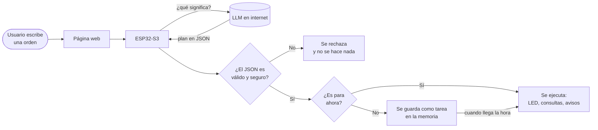

# ¿Cómo funciona? (explicado paso a paso)

Este documento explica el proyecto para alguien que **no** conoce de microcontroladores
ni de inteligencia artificial.

## 1. Las piezas

| Pieza | Qué es | Qué hace en el proyecto |
|-------|--------|-------------------------|
| **ESP32-S3** | Una pequeña computadora (microcontrolador) con Wi-Fi | Es el "cerebro" que controla todo |
| **LED** | Lucecitas | Representan las **luces** y los **aspersores** de la empresa |
| **Interruptores** | Botones que se quedan en una posición | Representan **puertas** y **ventanas** (abierta / cerrada) |
| **LLM** (Claude) | Un modelo de lenguaje en internet, como ChatGPT | **Entiende** las órdenes escritas en español |
| **Página web** | La interfaz que se abre en el navegador | Donde el usuario escribe las órdenes y ve el estado |

## 2. El recorrido de una orden



Ejemplo con la orden **«A las 8:00 p. m. enciende la luz de la entrada»**:

1. El usuario la escribe en la página web y pulsa *Enviar*.
2. El ESP32 se la envía al LLM junto con unas instrucciones que le explican qué
   dispositivos existen y en qué formato debe responder.
3. El LLM responde con un **JSON** (un texto con estructura que una máquina entiende fácil):
   ```json
   {"tipo": "plan", "mensaje": "Encender luz de entrada a las 20:00",
    "acciones": [{"accion": "encender", "dispositivo": "luz_entrada", "hora": "20:00"}]}
   ```
4. El ESP32 **revisa** ese JSON: ¿la acción `encender` está permitida? ¿existe `luz_entrada`?
   ¿`20:00` es una hora válida? Todo bien → lo acepta.
5. Como es para las 20:00, lo guarda como **tarea #1** en su memoria.
6. A las 20:00 el ESP32 enciende el LED del pin 4. 💡

## 3. La idea más importante: el LLM interpreta, el ESP32 decide

El LLM **nunca** controla los pines directamente. Solo puede elegir entre 6 acciones
permitidas (el *catálogo de funciones autorizadas*, en `plan.cpp`):

| Acción | Qué hace |
|--------|----------|
| `encender` | Enciende una luz, un aspersor o un grupo |
| `apagar` | Los apaga |
| `avisar` | Muestra una alerta en la página y hace parpadear el LED rojo |
| `consultar_accesos` | Dice qué puertas/ventanas están abiertas |
| `listar_tareas` | Lista las tareas programadas |
| `cancelar_tarea` | Cancela una tarea |

¿Por qué así? Porque un LLM **puede equivocarse** o inventar cosas. Si respondiera
"enciende la luz_cocina" (que no existe) o "abre la puerta" (las puertas solo se vigilan),
el ESP32 lo detecta y **no hace nada**. Si una orden tiene varias acciones y **una sola**
está mal, se rechaza la orden completa, para no dejar las cosas a medias.

### Las condiciones las revisa el ESP32, no el LLM

En «si todas las puertas están cerradas, apaga las luces», el LLM no sabe cómo están
las puertas. Por eso solo escribe `"condicion": "puertas_cerradas"`, y **el ESP32 mira
los interruptores reales** justo en el momento de ejecutar. Si alguna está abierta,
no apaga las luces y explica por qué.

### Las órdenes ambiguas se preguntan

«Enciende los aspersores **más tarde**» no dice a qué hora. El ESP32 detecta esas
palabras (`esAmbigua()` en `plan.cpp`) y **pregunta** antes de guardar nada:
*«¿A qué hora o en cuántos minutos?»*. Además, el LLM tiene instrucciones de hacer lo
mismo (`"tipo": "aclaracion"`). Cuando el usuario responde, la página envía la orden
original junto con la respuesta.

## 4. Hacer varias cosas a la vez (sin detenerse)

Consultar al LLM tarda unos segundos. Si el ESP32 se quedara "esperando", dejaría de
vigilar las puertas. Para evitarlo, el ESP32-S3 aprovecha sus **dos núcleos**:

| Núcleo | Qué hace | Archivo |
|--------|----------|---------|
| Núcleo 1 — `tareaMonitoreo` | Cada 50 ms lee los interruptores; cada segundo revisa si alguna tarea ya debe ejecutarse | `AgenteESP32.ino` |
| `loop()` | Atiende la página web y espera al LLM | `AgenteESP32.ino`, `servidor_web.cpp` |

Ninguno usa `delay()` largos para esperar las tareas: se compara la hora actual con la
hora de cada tarea (como mirar el reloj de vez en cuando, en vez de quedarse dormido).

Como las dos partes usan la misma lista de tareas, se protege con un **candado**
(`SemaphoreHandle_t`, un *mutex*): mientras una parte modifica la lista, la otra espera
unos microsegundos.

## 5. La hora (NTP)

El ESP32 no tiene reloj con pila. Al conectarse a internet pide la hora a un servidor
**NTP** (`pool.ntp.org`) y la ajusta a la zona horaria de `config.h` (Colombia, UTC-5,
por defecto). Mientras no tenga la hora, **no acepta órdenes con horario** (no sabría
cuándo ejecutarlas), pero sí órdenes inmediatas.

## 6. ¿Qué pasa si algo falla?

### Sin Wi-Fi
- Al arrancar intenta conectarse durante 15 segundos. Si no puede, crea su propia red
  **«Agente-ESP32»** (clave `agente1234`). Conectándose a ella, la página está en
  **http://192.168.4.1**.
- Las puertas se siguen vigilando, los botones de la página funcionan y las tareas ya
  programadas se ejecutan (si la hora ya se había sincronizado).
- Las órdenes en lenguaje natural responden *«Sin conexión a internet»*: sin internet no hay LLM.
- Si el Wi-Fi se pierde durante el funcionamiento, aparece una alerta y el ESP32 sigue
  intentando reconectarse solo.

### Si falla la API del LLM
- (Clave incorrecta, sin saldo, servidor caído, respuesta extraña...)
- La página muestra el error, se genera una alerta y **no se ejecuta nada**.
- Todo lo demás sigue funcionando normalmente.

### Después de un reinicio (o corte de luz)
- Todas las luces y aspersores arrancan **apagados** (lo más seguro).
- Las tareas pendientes **se recuperan** de la memoria no volátil (NVS, una memoria que
  no se borra al apagar) y aparece el aviso *«Se recuperaron N tarea(s)»*.
- Esperan a que el NTP dé la hora y luego se ejecutan normalmente.
- Si una tarea debía ejecutarse hace **más de 10 minutos** (el equipo estuvo apagado),
  **no se ejecuta tarde**: se avisa con una alerta. Así no se encienden los aspersores a
  las 3 a. m. porque la luz volvió tarde.

## 7. ¿Qué hace cada archivo?

| Archivo | En palabras simples |
|---------|---------------------|
| `AgenteESP32.ino` | El inicio: conecta el Wi-Fi, arranca el monitoreo y el servidor web |
| `config.h` | Ajustes: pines, zona horaria, nombre de la red de respaldo |
| `credenciales.h` | Tus claves (no se sube a GitHub) |
| `dispositivos.cpp` | La lista de luces, aspersores, puertas y ventanas, y cómo leerlos/encenderlos |
| `plan.cpp` | Revisa el JSON del LLM y ejecuta las acciones permitidas |
| `tareas.cpp` | Guarda las tareas programadas y las ejecuta a su hora |
| `avisos.cpp` | Lista de notificaciones y LED rojo de alerta |
| `llm.cpp` | Habla con la API de Claude por internet |
| `servidor_web.cpp` | Atiende la página web y la API |
| `pagina_web.h` | El diseño de la página (HTML) |

## 8. Seguridad de las claves

- Las claves van en `credenciales.h`, que está en `.gitignore`: **nunca** se sube a GitHub.
- La página web y la API **no muestran** las claves en ningún momento.
- La conexión con el LLM va cifrada (HTTPS). Por simplicidad no se verifica el
  certificado del servidor (`setInsecure()`); en un producto real se debería verificar.
- Si alguna vez subes una clave por error, **bórrala desde la consola del proveedor** y crea otra.
