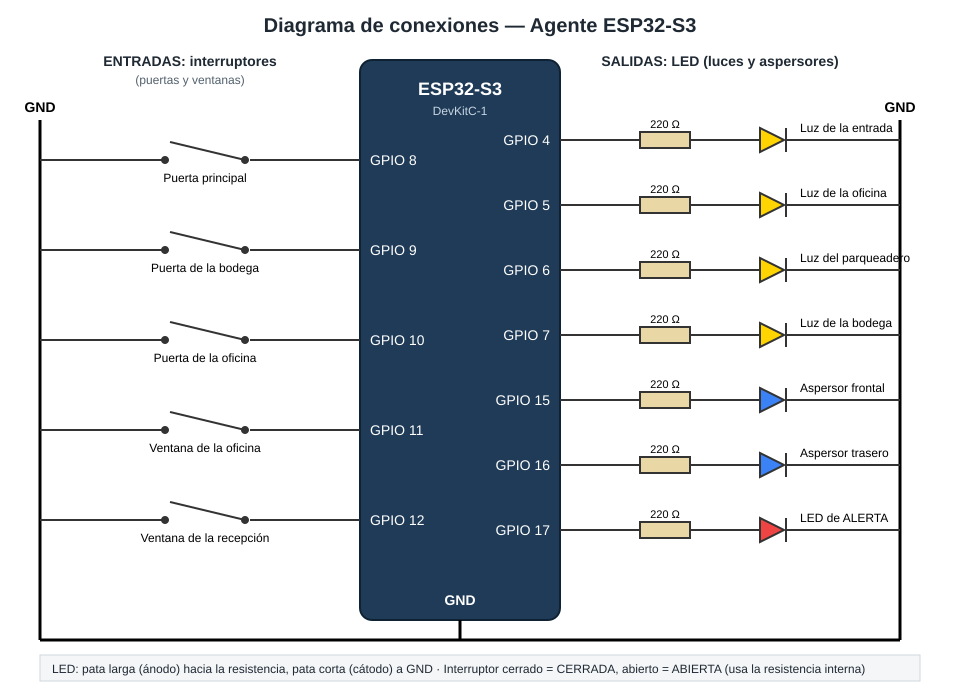

# Conexiones (hardware)

Solo hay **LED**: 6 para las luces de las habitaciones y 2 para indicar si el asistente
entendió la orden. No se conecta nada a 110/220 V.



## Materiales

| Cantidad | Componente |
|:--:|------------|
| 1 | ESP32-S3 DevKitC-1 (o similar) |
| 6 | LED amarillos (o blancos) — luces de las habitaciones |
| 1 | LED verde — «entendido» |
| 1 | LED rojo — «no entendí» |
| 8 | Resistencias de 220 Ω (sirven de 220 a 330 Ω) |
| 1 | Protoboard |
| ~12 | Cables dupont macho-macho |
| 1 | Cable USB **de datos** |

## Tabla de pines

| GPIO | LED | Representa |
|:--:|-----|------------|
| 4 | amarillo | Recepción |
| 5 | amarillo | Oficina |
| 6 | amarillo | Sala de juntas |
| 7 | amarillo | Cocina |
| 15 | amarillo | Baño |
| 16 | amarillo | Bodega |
| 17 | verde | Orden entendida |
| 18 | rojo | No entendí |

Para cambiar un pin, edita la tabla `HABITACIONES` (sección 2 del código) o
`PIN_LED_ENTENDIDO` / `PIN_LED_NO_ENTENDIDO`. Se evitaron los pines que el ESP32-S3 usa al
arrancar (0, 3, 45, 46), los del USB (19, 20) y los de la memoria (26 a 37).

## Cómo conectar cada LED

```
 GPIO ──── resistencia 220 Ω ──── pata LARGA del LED (ánodo)
                                  pata CORTA del LED (cátodo) ──── GND
```

- El LED tiene polaridad: si se conecta al revés, no enciende (pero no se daña).
- La resistencia puede ir antes o después del LED; lo importante es que esté.
- Todas las patas cortas van al **mismo GND**.

## Paso a paso en la protoboard

1. Coloca la ESP32 sobre el centro de la protoboard, con cada fila de pines a un lado del canal central.
2. Con un cable, une un pin **GND** de la placa a la línea azul (−) de la protoboard: ese será el **riel de GND**.
3. Para cada fila de la tabla:
   1. Pon la resistencia desde el GPIO hacia una fila libre de la protoboard.
   2. En esa fila pon la **pata larga** del LED.
   3. Lleva la **pata corta** al riel de GND.
4. Revisa que cada LED quede en el pin de la tabla.

## Comprobar el montaje

Al subir el programa todos los LED quedan apagados. Prueba desde el Monitor Serie:

```
prende todas las luces
```

Deben encenderse los 6 amarillos y parpadear el verde 3 veces. Si alguno no enciende:
- Está al revés: gira el LED.
- Revisa que su pata corta llegue a GND y que esté en el pin correcto.

## Diagrama en texto

```
                    ESP32-S3
                 ┌────────────┐
  Recepción   ◄──┤ 4          │
  Oficina     ◄──┤ 5          │
  Sala juntas ◄──┤ 6          │
  Cocina      ◄──┤ 7          │
  Baño        ◄──┤ 15         │
  Bodega      ◄──┤ 16         │
  LED verde   ◄──┤ 17         │
  LED rojo    ◄──┤ 18     GND ├──── riel GND (todas las patas cortas)
                 └────────────┘
  (cada ◄── es: resistencia 220 Ω + LED)
```
